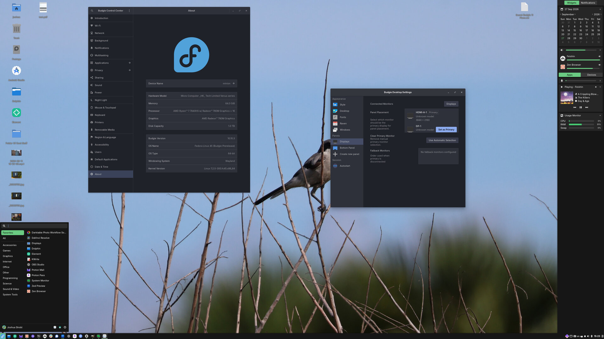

This document provides guidance on writing documentation for Buddies of Budgie. This is not intended to be an all-encompassing document, however it will strive to provide links to any extra resources to make your documentation writing as easy as possible.

## What Should Be Documented?

Buddies of Budgie documentation is intended to cover the following:

- Day-to-day usage of Budgie Desktop, with useful information to new and existing users alike. This can be everything from keybinds to how to install Budgie Desktop on various operating systems. It is not intended to replace documentation for those specific operating systems or any applications those operating systems / curated experiences provide, but useful guidance on navigating around various "core" Budgie Desktop functionality and features.
- Developing Budgie Desktop or "on top of" the desktop with our panel and Raven widget APIs.

## Before Getting Started

If you would like to write some documentation but aren't sure where to start, our recommendation would be to take a look at our [issue tracker](https://github.com/BuddiesOfBudgie/docs/issues) which may have requested documentation.

:::info
All of our [documentation](https://github.com/BuddiesOfBudgie/docs), including the site itself, is open source, meaning you can take a look at how it all works under the hood!
:::

If you have an idea of some documentation to write, we suggest taking a look at the issue tracker linked above or see if someone else had a similar idea by taking a look at our [pull requests](https://github.com/BuddiesOfBudgie/docs/pulls).

Writing documentation requires _some_ technical knowledge, but it isn't anything we believe you can't learn if you haven't already! In some cases, issues can just be solved with some copy / paste and editing.

The process of writing and submitting documentation requires that you "fork" our GitHub repository linked above. Forking is effectively creating your own copy of our documentation (like this one!) and the source code for this documentation site. To do all of this, you will need an account with GitHub, where our documentation repository lives.

:::note
The source code for our main website, [buddiesofbudgie.org](https://buddiesofbudgie.org), lives on [our Forge](https://forge.moderndesktop.dev/BuddiesOfBudgie/site). Its copy on GitHub is a read-only mirror.
:::

:::note
GitHub accounts are free and you can create one just by visiting their [sign up](https://github.com/signup) page.
:::

Have an account? Great! Now it's time to [fork the docs repository](https://github.com/BuddiesOfBudgie/docs/fork). You should be greeted with a page with pre-filled details. Make sure the owner is you, then click "Create fork".

You will need to now "clone" your fork to your computer. There is a bunch of different ways to do that, from the command-line to various graphical programs. Given that fact, we would just recommend you check out [GitHub's documentation](https://docs.github.com/en/repositories/creating-and-managing-repositories/cloning-a-repository).

:::tip[Need help?]
You can reach out to us on our [Matrix Space](https://matrix.to/#/#buddies-of-budgie:matrix.org) for guidance if you run into issues.
:::

## Where Documentation Lives

Documentation is versioned to match Budgie Desktop releases. Pick the folder that matches the release your documentation is about:

| Folder                          | Covers                                                                   |
| ------------------------------- | ------------------------------------------------------------------------ |
| `versioned_docs/version-10.10/` | Budgie Desktop 10.10.x, the currently supported release                 |
| `docs/`                         | The current, unversioned documentation, including Budgie 11 and organization-wide pages |

Budgie Desktop 10.9.x and earlier are unsupported, so do not add or update documentation for them.

Within each version, user documentation goes in `user/` and developer documentation in `developer/`. For example, a page about the developer workflow for Budgie Desktop 10.10 goes in `versioned_docs/version-10.10/developer/workflow/`. If you aren't sure, that's fine, we can always move the file later or invent a new category.

## The Writing

Documentation is written in either [GitHub-flavored Markdown (GFM)](https://github.github.com/gfm/) (`.md` files) or [MDX](https://mdxjs.com) (`.mdx` files). Most documentation can be written in GFM. Use MDX when you need components, such as tabs. For really fancy docs, be sure to take a look at Docusaurus' [Markdown Features](https://docusaurus.io/docs/markdown-features).

[Docusaurus](https://docusaurus.io), the tooling we use to provide this nifty documentation center, has [documentation on creating a document](https://docusaurus.io/docs/create-doc). The basics are:

1. Figure out where the doc goes, using [Where Documentation Lives](#where-documentation-lives) above.
2. Create a file in the respective folder with the file extension `.md` (or `.mdx` if you use components). For example, "Hello World" should be all lowercased with spaces replaced with `-`, so `hello-world.md`.
3. Create the header of the file. There is a lot of ["front matter" options](https://docusaurus.io/docs/api/plugins/@docusaurus/plugin-content-docs#markdown-front-matter), but just stick with the basics of a `title` and `description` for now per the linked documentation for Docusaurus.

After that, just start writing!

### Formatting

[Admonitions](https://docusaurus.io/docs/markdown-features/admonitions) highlight information that should stand out from the rest of the page:

| Admonition    | Use it for                                                            |
| ------------- | --------------------------------------------------------------------- |
| `:::note`     | Extra information the reader may find useful                          |
| `:::tip`      | Suggestions that make something easier                               |
| `:::info`     | Context the reader should know before continuing                     |
| `:::warning`  | Something that may cause problems if done incorrectly                |
| `:::danger`   | Something that can break the reader's system or lose data            |

For example:

```md
:::warning
Without support for this protocol, you should not expect correct positioning.
:::
```

Each admonition shows its type as the title by default, such as "Warning". To use a custom title, put it in square brackets after the type:

```md
:::info[labwc bridge]
Budgie Desktop offers a "labwc bridge" out-of-the-box.
:::
```

When content differs between distributions or shells, use [tabs](https://docusaurus.io/docs/markdown-features/tabs) in an `.mdx` file. Give each set of tabs a `groupId`, and use the same `value` for the same option across sets, so that choosing a tab in one set switches the others on the page too:

```mdx
import Tabs from "@theme/Tabs";
import TabItem from "@theme/TabItem";

<Tabs groupId="operating-systems">
  <TabItem value="fedora" label="Fedora">
    Fedora-specific instructions.
  </TabItem>
  <TabItem value="solus" label="Solus">
    Solus-specific instructions.
  </TabItem>
</Tabs>
```

### Previewing Your Changes

Follow the [README](https://github.com/BuddiesOfBudgie/docs#readme) to install the tooling. Then run `bun run start` for a live preview of the documentation and how your doc will look in the live environment for the rest of the world to see.

Before submitting your changes, run `bun run build`. The build fails if any page links to a page that does not exist, so it catches broken links before reviewers do.

## Submitting a Pull Request

Before submitting, read our [Contributing](/developer/contributing) guidelines. In particular:

- Every commit must be signed off for the Developer Certificate of Origin by committing with `git commit -s`. Pull requests with commits that are not signed off fail our DCO check.
- Commit messages follow [Conventional Commits](https://www.conventionalcommits.org/).
- If you used AI tools, you must follow our [AI Policy](/organization/ai-policy).

Submitting a pull request can be done through our [GitHub repository](https://github.com/BuddiesOfBudgie/docs). GitHub has [excellent documentation](https://docs.github.com/en/pull-requests/collaborating-with-pull-requests/proposing-changes-to-your-work-with-pull-requests/creating-a-pull-request) that can walk you through this process. Since you will likely be working on a "fork" of the repository, it is recommended to follow GitHub's documentation on [creating a pull request from a fork](https://docs.github.com/en/pull-requests/collaborating-with-pull-requests/proposing-changes-to-your-work-with-pull-requests/creating-a-pull-request-from-a-fork).

## Recommendations

### Assets

Docusaurus supports [adding assets](https://docusaurus.io/docs/markdown-features/assets), such as images, to a document. Please keep assets in an `assets/document-name-here` folder relative to the Markdown file.

:::tip[Example]
Assets for this document, located at `versioned_docs/version-10.10/developer/meta/writing-documentation.md`, reside in `versioned_docs/version-10.10/developer/meta/assets/writing-documentation`. We have an example below for reference (and testing!)
:::



Transparency should be used sparingly as our documentation center supports both light and dark theme. Using images that look good against a light background may make them unreadable on a dark one, and vice-versa. You can use [Themed Images](https://docusaurus.io/docs/markdown-features/assets#themed-images) in MDX, but consider if that is necessary first!

Images should be compressed without noticeable artifacting, preferably in JPG.
